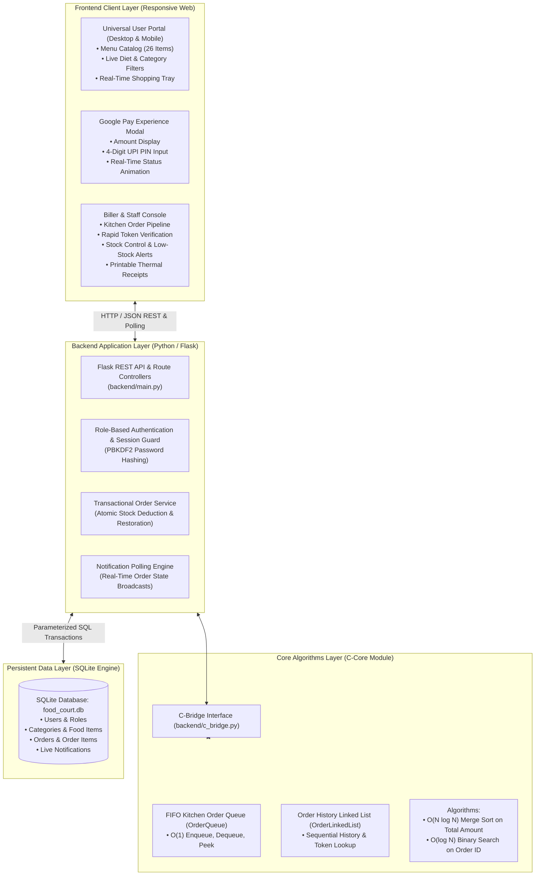
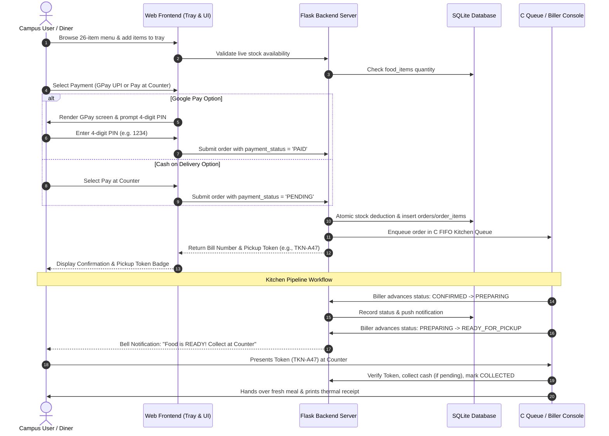
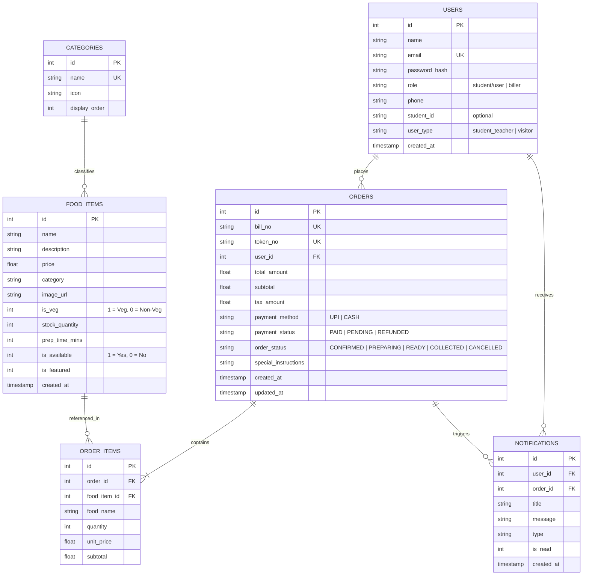

# Smart Campus Food Court Ordering System (CampusBite)
## Presentation & Slide Deck Guide

---

### Slide 1: Title Slide
* **Title:** CampusBite — Smart Campus Food Court Ordering System
* **Subtitle:** Modern, Queue-Free Campus Dining with Dual-Role Portals & High-Performance C-Core Data Structures
* **Presenter Information:** [Your Name / Team Members / Department]
* **Institution:** [College / University Name]
* **Date:** October 2026

---

### Slide 2: Problem Statement & Motivation
* **Long Waiting Queues:** Peak interval rushes (lunch hour, recess) lead to crowded canteen counters and delayed meal pickups.
* **Cashier Bottlenecks:** Manual order entry, paper slips, and loose change calculations slow down food court billing.
* **Stock & Inventory Inaccuracies:** Cashiers accept orders for items that have run out in the kitchen, leading to manual refunds and food waste.
* **Lack of Live Tracking:** Diners stand around crowded pickup counters without knowing whether their food is being cooked or ready.
* **Inclusive Campus Audience:** Dining needs extend beyond students to teachers, campus staff, visiting parents, and external guests.

---

### Slide 3: Proposed Solution
* **Queue-Free Digital Ordering:** Diners order and customize meals from their mobile devices or laptops before arriving at the counter.
* **Dual-Role Architecture:**
  * **User Portal:** Universal ordering experience for students, teachers, parents, and visitors.
  * **Biller / Admin Console:** High-efficiency kitchen pipeline, counter token verification, and stock manager.
* **Smart Pickup Tokens & Receipts:** Distinctive alphanumeric tokens (`TKN-xx`) and unique bill numbers (`BILL-xxxxx`).
* **Realistic GPay / UPI & Cash Options:** Dual payment flexibility with 4-digit PIN verification or Pay-at-Counter cash collection.
* **Computer Science Foundation:** Integrated C data structures (FIFO Queue, Linked List, Merge Sort, Binary Search) powering fair order fulfillment.

---

### Slide 4: System Architecture



---

### Slide 5: End-to-End Workflow Diagram



---

### Slide 6: Module Descriptions

#### 1. Universal User Ordering Module (`frontend/templates/student_dashboard.html`, `cart.html`, `orders.html`)
* **Multi-Filter Food Catalog:** 26 curated dishes with live Veg / Non-Veg toggles and category chips (*South Indian, North Indian, Combos & Thali, Snacks, Beverages, Desserts*).
* **Tray & Stock Protection:** Real-time quantity steppers, subtotal updates, and prevention of orders exceeding remaining kitchen portions.
* **Live Lifecycle Stepper:** Visual step indicator tracking `Confirmed` &rarr; `Preparing` &rarr; `Ready for Pickup` &rarr; `Collected`.
* **Fair Cancellation Rules:** Instant user cancellation and automatic inventory restoration allowed during `CONFIRMED` phase; locked once preparation starts.

#### 2. Realistic Google Pay (GPay) Payment Engine (`frontend/templates/cart.html`)
* **Two-Step Authentic Interface:**
  * **Step 1:** Merchant overview showing payable amount and ICICI UPI ID.
  * **Step 2:** Interactive 4-digit PIN keypad with auto-advancing digit boxes and one-click demo auto-fill (`1234`).
  * **Step 3:** Verified transaction animation with generated bank reference number.
* **Pay at Counter (Cash) Fallback:** Generates pickup token immediately with pending cashier settlement.

#### 3. Biller & Kitchen Management Console (`frontend/templates/biller_dashboard.html`)
* **Live Order Processing Pipeline:** Step-by-step progress buttons (`Start Prep`, `Ready for Pickup`, `Mark Collected`).
* **Fast Token & Bill Verification:** Instant counter lookup when diners present their token.
* **Inventory Control & Stock Adjustments:** Real-time price edits, portion restock, and instant Available / Out-of-Stock toggles.
* **Low-Stock Alert Center:** Highlights any menu item with 10 or fewer portions remaining.
* **Printable Thermal Receipts:** Official dining receipts containing itemized rates, GSTIN, timestamps, and customer details.

#### 4. C-Core High-Performance Algorithms (`c_core/food_court_ds.c`, `backend/c_bridge.py`)
* **FIFO Order Queue:** $O(1)$ operations strictly enforcing kitchen preparation fairness.
* **Order History Linked List:** Dynamic memory list enabling fast linear lookups by token and bill numbers.
* **Merge Sort Algorithm:** $O(N \log N)$ recursive divide-and-conquer sorting for total order values.
* **Binary Search Algorithm:** $O(\log N)$ indexed lookups on sorted order arrays.

---

### Slide 7: Database Design & Schema Architecture

The persistent layer is built using **SQLite** (`food_court.db`) with foreign key constraints, indexation, and ACID transactions:



---

### Slide 8: Dataset & Seed Details

| Category | Item Count | Representative Dishes & Portions | Pricing Range |
| :--- | :---: | :--- | :---: |
| **South Indian** | 4 | Masala Dosa, Ghee Podi Dosa, Idli Vada Combo, Onion Uttapam | ₹60.00 – ₹90.00 |
| **North Indian** | 4 | Paneer Butter Masala, Chole Bhature, Butter Chicken Box, Dal Makhani | ₹95.00 – ₹175.00 |
| **Combos & Thali** | 4 | Veg Dum Biryani, Chicken Biryani Special, Mini Thali, Fried Rice Combo | ₹120.00 – ₹160.00 |
| **Snacks & Chaat** | 6 | Grilled Sandwich, Samosa Plate, Peri Peri Fries, Pani Puri, Franky Roll, Pav Bhaji | ₹40.00 – ₹85.00 |
| **Beverages & Juices** | 5 | South Indian Filter Coffee, Mango Lassi, Cold Coffee, Fresh Mojito, Masala Chai | ₹25.00 – ₹65.00 |
| **Desserts** | 3 | Gulab Jamun (2 pcs), Sizzling Walnut Brownie, Chilled Rasmalai | ₹45.00 – ₹85.00 |
| **Total Catalog** | **26 Items** | **Available in Pure Veg & Non-Veg with customized prep times (2m – 14m)** | **₹25.00 – ₹175.00** |

---

### Slide 9: Tools & Technologies Used

```
┌────────────────────────────────────────────────────────────────────────┐
│                        TOOLS & TECHNOLOGIES STACK                      │
├─────────────────┬──────────────────────────────────────────────────────┤
│ Frontend        │ • HTML5 & CSS3 (Custom warm cream/green palette)     │
│                 │ • Bootstrap 5.3.3 (Responsive Grid System)           │
│                 │ • Bootstrap Icons 1.11.3 & Plus Jakarta Sans Font    │
│                 │ • JavaScript (ES6+ Custom Cart & Polling Engine)     │
├─────────────────┼──────────────────────────────────────────────────────┤
│ Backend         │ • Python 3.14 / Flask 3.1                            │
│                 │ • Werkzeug Security (PBKDF2 Password Hashing)        │
│                 │ • Flask-CORS (Cross-Origin Resource Sharing)         │
│                 │ • RESTful API Architecture                           │
├─────────────────┼──────────────────────────────────────────────────────┤
│ Data Structures │ • C Language (ISO C99 standard)                      │
│ & Algorithms    │ • GCC Compiler / MinGW                               │
│                 │ • ctypes & Subprocess Python Integration Bridge      │
├─────────────────┼──────────────────────────────────────────────────────┤
│ Database        │ • SQLite 3 (ACID compliant, zero-configuration)      │
│ & Storage       │ • LocalStorage (Client-side tray persistence)        │
├─────────────────┼──────────────────────────────────────────────────────┤
│ Developer Tools │ • Visual Studio Code                                 │
│                 │ • Git Version Control                                │
│                 │ • Windows PowerShell                                 │
└─────────────────┴──────────────────────────────────────────────────────┘
```

---

### Slide 10: Key Results & Impact
* **Elimination of Queue Bottlenecks:** Diners arrive at the counter only when their token transitions to `Ready for Pickup`.
* **Zero Inventory Drift:** Atomic stock deductions at order time prevent overbooking and cancellation disputes.
* **Rapid Cash & Digital Settlement:** Instant GPay simulated approvals and 1-click counter cash reconciliations.
* **Campus Inclusivity:** Universal account structure accommodates students, faculty, staff, parents, and visitors alike.
* **Operational Transparency:** Biller console analytics display real-time daily revenue, active kitchen queue size, and low-stock warnings.

---

### Slide 11: Future Enhancements & Conclusion
* **Smart Locker Pickup Integration:** Secure automated warm lockers opened by QR code / token.
* **Push Notifications & SMS Alerts:** WhatsApp/SMS webhooks triggered when food is ready.
* **Kitchen Display System (KDS):** Kitchen wall display for chef line items grouped by prep time.
* **Conclusion:** CampusBite delivers a production-grade, full-stack food court ordering platform that pairs modern responsive web design with foundational computer science data structures.
